# HR-01 presenter guide

**Workshop: Monday 23 November 2026, 13:30 — SMG (Maison Samira Maatouk Morocco)**

This is everything you need to give the demo. You do not need to understand the
code. Follow it in order: the checklist before the meeting, then the six scenes,
then the decisions page.

Two things to know before you read on:

- **Everything on screen is invented.** 148 made-up people, made-up CIN, CNSS and
  RIB numbers, made-up salaries. There is no SMG data anywhere in it. Say so
  early — it is reassuring, and it is true.
- **The date inside the demo is fixed at 23 November 2026.** Everything is
  written around that day: the contract that ends "this month", the documents
  expiring "in 30 days".

---

## Demo accounts

All four were signed in and checked this morning. **No authenticator code is
asked for today** — see *Before the meeting*, step 4.

| Name | Email | Password | Chrome profile | What they can see |
|---|---|---|---|---|
| **Salma Benali** — HR | `hr@smg-demo.test` | `CPeople-Test-2027!` | **HR Salma** | The whole company: all **148** employees, their pay, CIN, CNSS, bank details and family. Can create and change files, generate contracts, upload documents, read the audit log. Opens in **French**. |
| **Rachid Kettani** — Manager (Kitchen) | `manager@smg-demo.test` | `CPeople-Test-2027!` | **Manager Rachid** | Only his own branch: the **46 Kitchen employees**. Salary, CIN, CNSS, RIB, address and family are **masked** (••••) on every one of their files. No Settings, no audit log. Opens in **English**. |
| **Karim Alaoui** — Employee | `employee@smg-demo.test` | `CPeople-Test-2027!` | **Employee Karim** | **His own file only** — one person in the list, which is him. He sees his own salary and bank details (everyone can see their own) and may correct his phone, address and e-mail. Opens in **French**. |
| **Amina Admin** — Administrator | `admin@smg-demo.test` | `CPeople-Test-2027!` | **Admin Amina** | Everything HR sees, plus changing the organisation: departments, cost centres, who heads what. Opens in **English**. |

These are local test accounts on your laptop with invented data. The passwords
are written here on purpose; there is nothing real behind them.

> **Language:** every window has an **EN / FR** button at the top right. Salma's
> and Karim's windows open in French — that is deliberate, it is how SMG's HR
> would use it. Switch either way at any moment; it is a good thing to show.

### Setting up the four Chrome windows (do this the day before)

Four separate Chrome **profiles** means four people signed in at once, with no
signing in and out in front of the client.

1. Open Chrome. Click your **profile picture, top right** → **Add** → **Continue
   without an account**.
2. Name it **HR Salma**, pick a colour, **Done**. A new Chrome window opens.
3. In that window, go to `http://localhost:3000` → **Sign in** → type
   `hr@smg-demo.test` → **Continue** → type the password → **Sign in**.
4. Repeat steps 1–3 for **Manager Rachid**, **Employee Karim** and **Admin
   Amina** with their own e-mails.
5. Leave all four windows open and signed in. Arrange them so you can switch with
   the taskbar, not with alt-tab roulette.
6. In each window, press **Ctrl +** two or three times until the text is big
   enough to read from the back of the room (about 125 %).

---

## Before the meeting

Give yourself **30 minutes**. Steps 1 to 5 take about five; the rest is the
rehearsal.

### 1. Start everything — one command

Open a terminal in the project folder (`C:\Projects\cpeople`) and run:

```
pnpm demo:start
```

That starts the database, the sign-in service, the file store and the document
service, loads the demo data, switches off the authenticator step and starts
CPeople. **Leave this window open for the whole meeting** — closing it stops the
demo.

Wait until the window stops scrolling and you can see a line saying
`CPeople API on http://localhost:3100/api`. It takes about a minute the first
time.

### 2. Check it is up

In a **second** terminal:

```
pnpm demo:check
```

You want six green `ok` lines and **"Everything the workshop needs is up."** If
anything says `DOWN`, go to *If something goes wrong* at the end of this guide.

### 3. Reset the demo data

Puts the 148 people back exactly as they should be, undoing any rehearsal:

```
pnpm demo:reset
```

Takes about half a minute. Safe to run as often as you like — **including in the
middle of the meeting** (see the end of this guide).

### 4. No authenticator codes today

`pnpm demo:start` has already done this. To check, `pnpm demo:check` says:

```
  ok    Two-step sign-in is off for the workshop
```

If it instead says `TODO  Two-step sign-in is ON`, run:

```
pnpm demo:prepare
```

Two-step sign-in with an authenticator app **is built and working** — it is one
of the questions you are asking SMG today. It is switched off only so that four
browser windows do not need four phones.

*(For the developers: while it is off, the two sign-in tests that are about the
code step skip themselves and say why. `pnpm demo:restore` brings them back.)*

> **After the meeting, put it back:**
> ```
> pnpm demo:restore
> ```
> That re-attaches the authenticator step to the Admin, HR and Payroll roles and
> puts session timeouts back to 30 minutes. Do it the same day.

### 5. The demo clock says 23 November 2026

Sign in to any window and look at the line under the greeting on the home page.
It must read:

> Monday, 23 November 2026. November payroll is in review.

If it shows a different date, the API was not started by `pnpm demo:start`. Stop
it (Ctrl+C in the first terminal) and run `pnpm demo:start` again.

### 6. Sessions last the whole meeting

`pnpm demo:prepare` sets windows to stay signed in for **four hours** idle. No
window will sign itself out during a two-hour meeting. (Normally it is 30
minutes; `pnpm demo:restore` puts that back.)

### 7. Rehearse

```
pnpm demo:rehearse
```

This walks scenes 1 to 5 by itself against a fresh reset, in about four minutes,
and fails loudly if anything is broken. Run it the evening before **and** on the
morning. Finish with `pnpm demo:reset` so the data is untouched when you start.

### Last check before 13:30

- [ ] Four Chrome windows open, each signed in as a different person
- [ ] `pnpm demo:check` all green
- [ ] `pnpm demo:reset` run, nothing from the rehearsal left on screen
- [ ] Home page shows **148 / 2 / 1 / 5** in the four cards
- [ ] Screen sharing tested, text size up

---

## Scene 1 · Roles and access — 13:30

**Window: HR Salma, then Manager Rachid, then Employee Karim, then back to HR.**

This is the scene that matters most. Everything else is detail.

### 1.1 Sign in, in front of them

Use the **HR Salma** window. Sign out first if you want to show the whole thing
(account button, top right → **Sign out**), or simply start here.

| Click | What appears |
|---|---|
| Go to `http://localhost:3000`, click **Sign in** | The CPeople sign-in page, with "Work email" |
| Type `hr@smg-demo.test`, click **Continue** | The password step. The address stays on screen with a **Change** link |
| Type the password, click **Sign in** | A short animation builds the CPeople logo, then the home page |

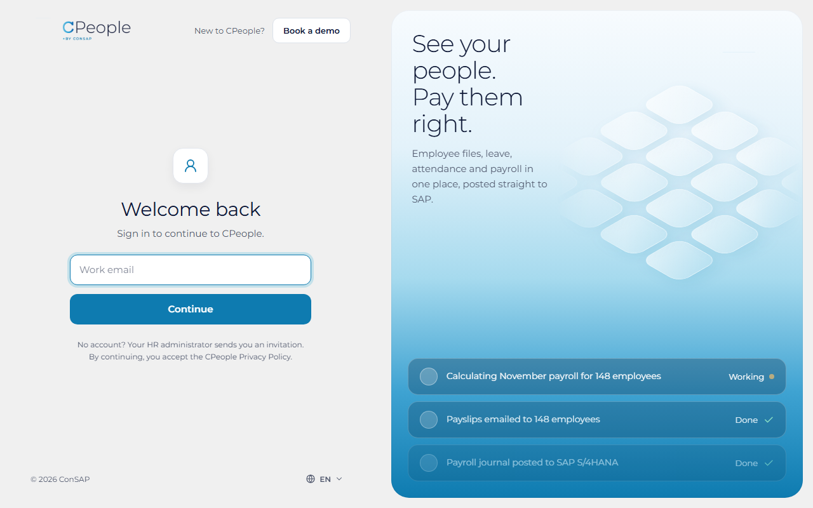

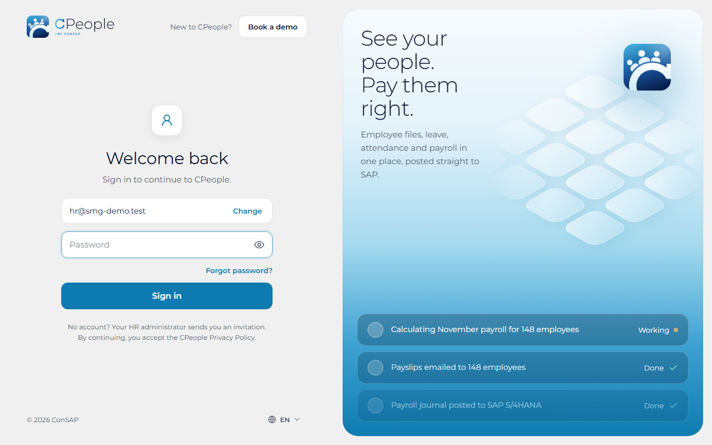

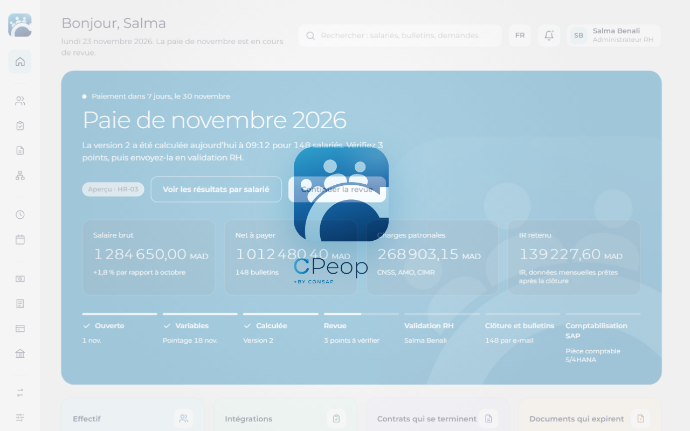

> "The e-mail step never contacts the server — CPeople will not tell anyone
> whether an address exists here. The password is checked by Keycloak, which is
> the same identity system behind the rest of your estate."

### 1.2 What HR sees

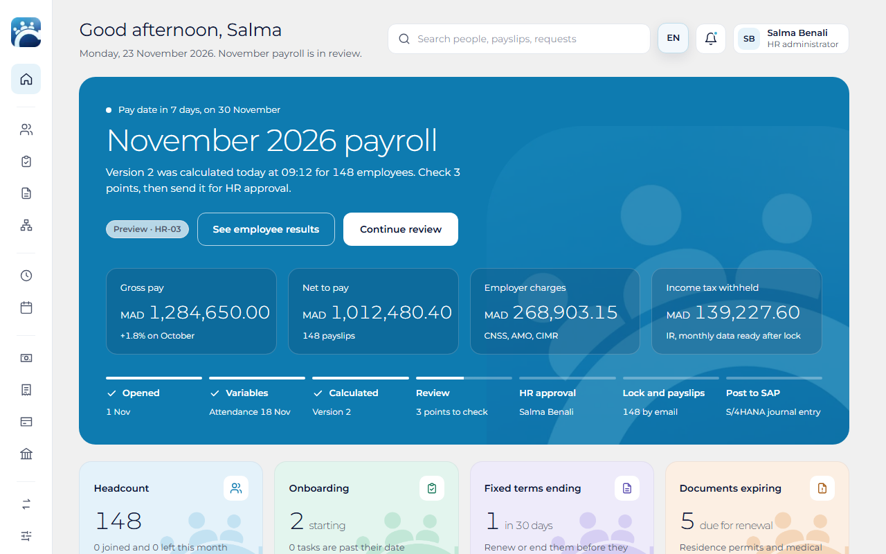

The four cards read **148**, **2 starting**, **1 in 30 days**, **5 due for
renewal**. These are counted live, not typed in.

> "Salma is HR. She sees the whole company: 148 people, two joining next week,
> one fixed-term contract ending this month, five documents that need
> renewing."

### 1.3 The same company, seen by a manager

Switch to the **Manager Rachid** window.

| Click | What appears |
|---|---|
| It is already on the home page | Headcount reads **46**, not 148 |
| Click **Employees** in the left menu | "46 employees" — his own branch of the kitchen |
| Click any name, then the **Pay and bank** tab | Salary, CNSS, bank and RIB all show **••••** |

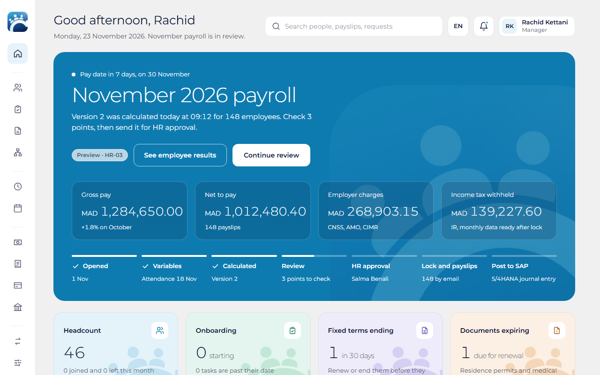

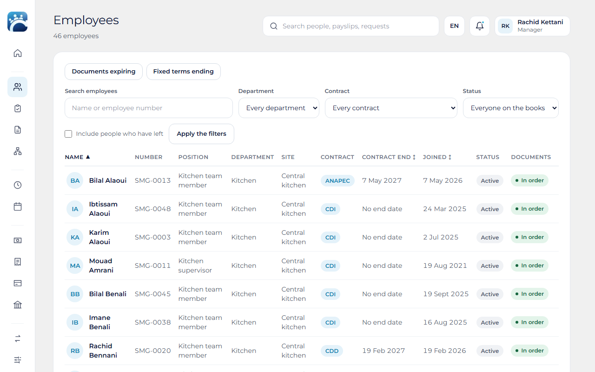

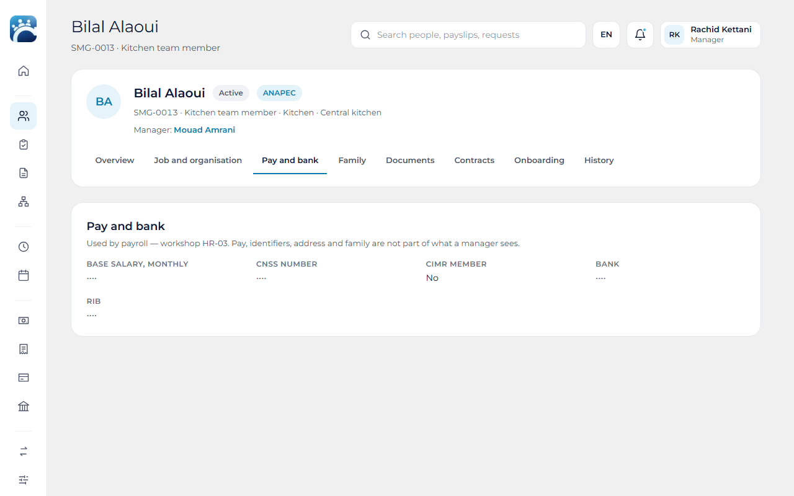

> "Rachid heads the kitchen. Same system, same screens — 46 people, and no pay,
> no CIN, no bank details. Those dots are not a style: the salary never leaves
> the server for him. It is not in the page, so it cannot be found by anyone
> looking."

### 1.4 And by an employee

Switch to the **Employee Karim** window, click **Employees**.

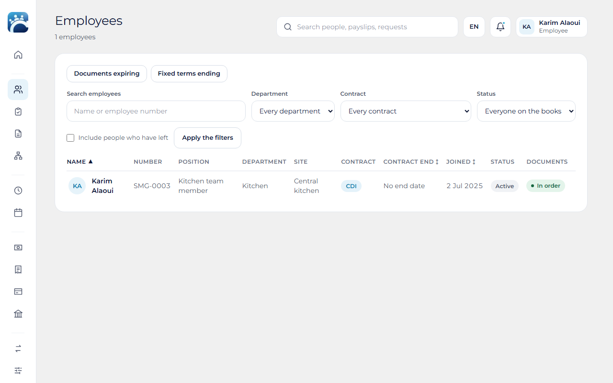

> "Karim sees one file: his own. He can correct his phone number and his address,
> and nothing else."

### 1.5 The matrix, and the trail

Back to the **HR Salma** window.

| Click | What appears |
|---|---|
| **Settings** in the left menu, then **Roles and access** | The matrix, with an orange **"Proposed — to confirm with SMG"** banner |
| **Settings** → **Audit log** | Every change, newest first, with who made it and in which role |

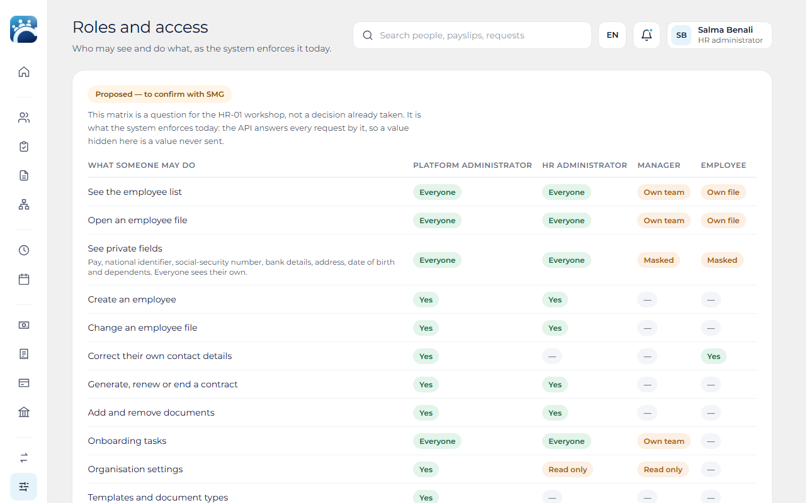

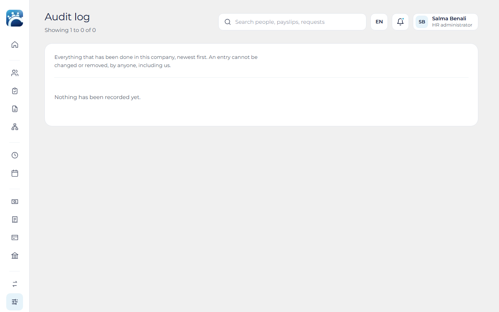

> "This matrix is our proposal, not a decision — it is one of the things we want
> from you today. And it is not a picture: the system answers every request by
> this table, so what you agree here is what the software enforces."

### ❓ Ask SMG

> **"Two-step sign-in with an authenticator app is built. Should it be on for
> Admin and HR only, or for every user?"**

Note the answer on the decisions page at the end.

### If it fails

- **A window asks for a 6-digit code:** run `pnpm demo:prepare` in the second
  terminal, then sign that window in again.
- **A window shows the sign-in page unexpectedly:** sign in again with the table
  above. It takes fifteen seconds and nobody minds.
- **The figures read `—` instead of numbers:** reload the page (F5). If they are
  still dashes, run `pnpm demo:check`.

---

## Scene 2 · The employee file — 13:50

**Window: HR Salma.**

| Click | What appears |
|---|---|
| Type `Karim` in the **Search employees** box on the Employees page, press Enter | One row: Karim Alaoui |
| Click his name | His file, **Overview** tab |
| Click through **Job and organisation**, **Pay and bank** | Seniority computed from his start date; pay tagged "Used by payroll — workshop HR-03" |
| Back on **Overview**, click **Edit** | The same layout, with input boxes |
| Change the phone to `+212 661 45 78 90`, click **Save** | Green line: "Saved. The change is in the history." |
| Click the **History** tab | The change, with the old and new number, Salma's name and her role |

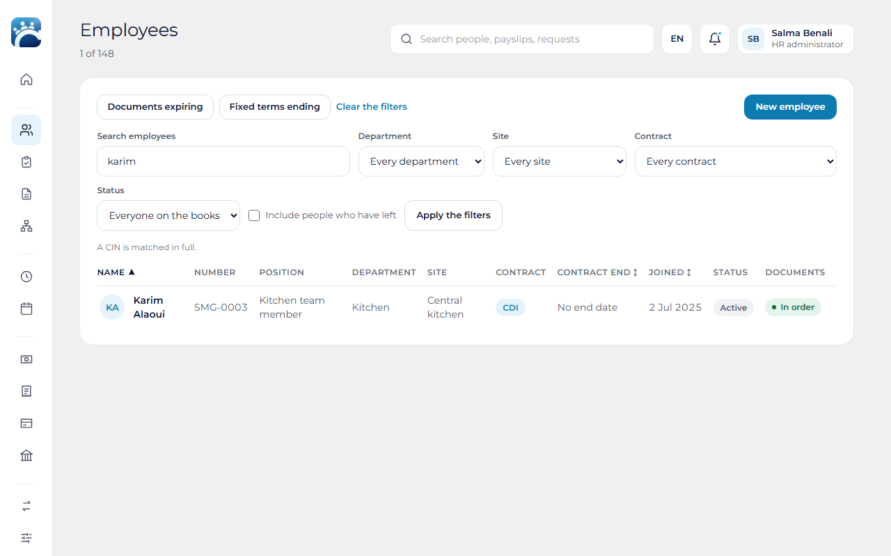

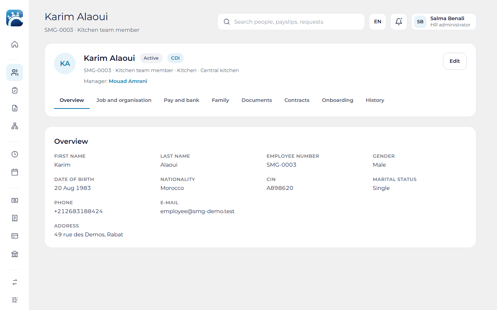

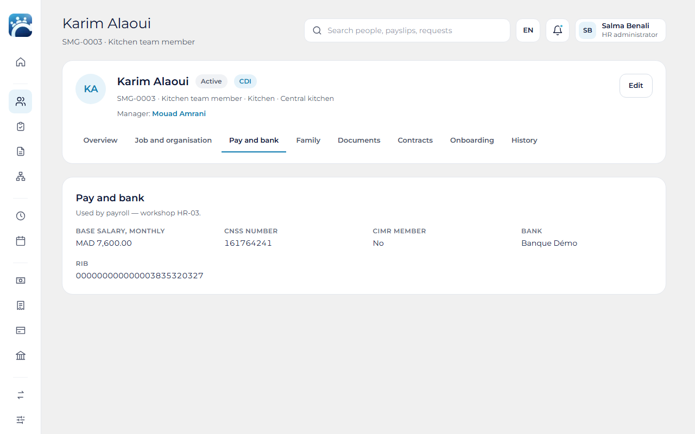

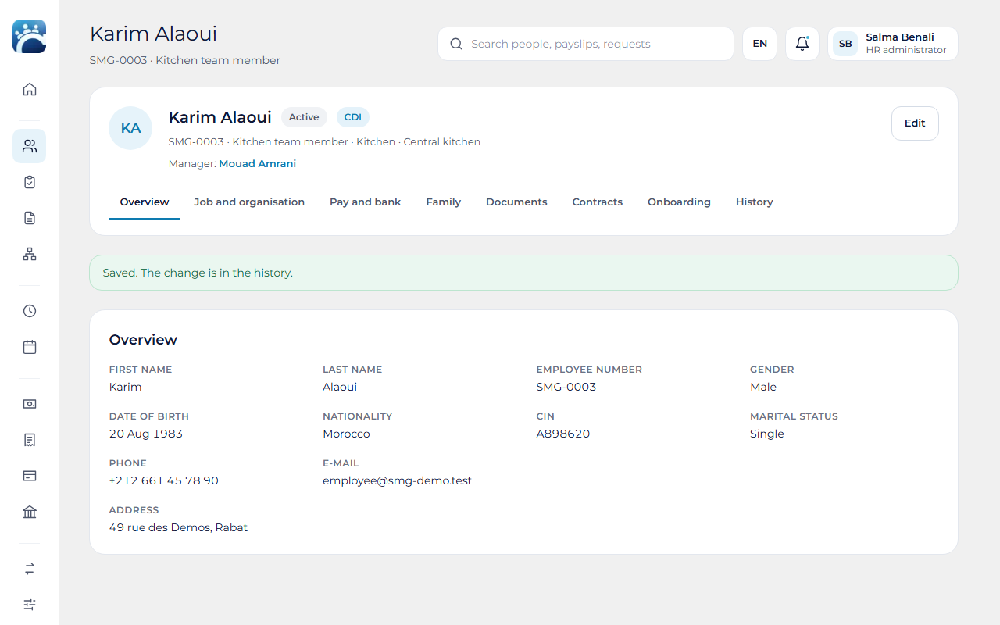

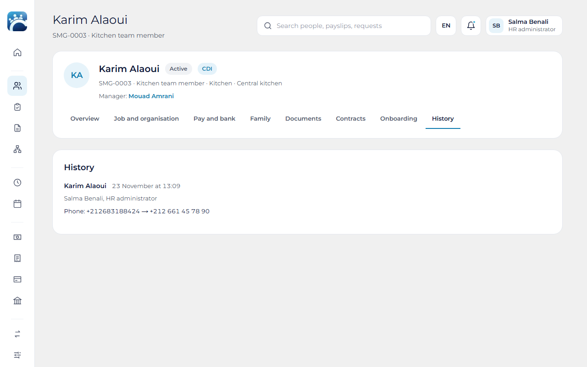

Then the document that changes a figure on the home page:

| Click | What appears |
|---|---|
| **Documents** tab → **Add a document** | A small form |
| Kind: **Medical aptitude certificate**; choose any PDF from your laptop; **Expires on** `2026-12-03`; **Add it to the file** | The document appears with an orange **"Expires in 10 days"** |
| Click **Home** in the left menu | "Documents expiring" has gone from **5** to **6** |

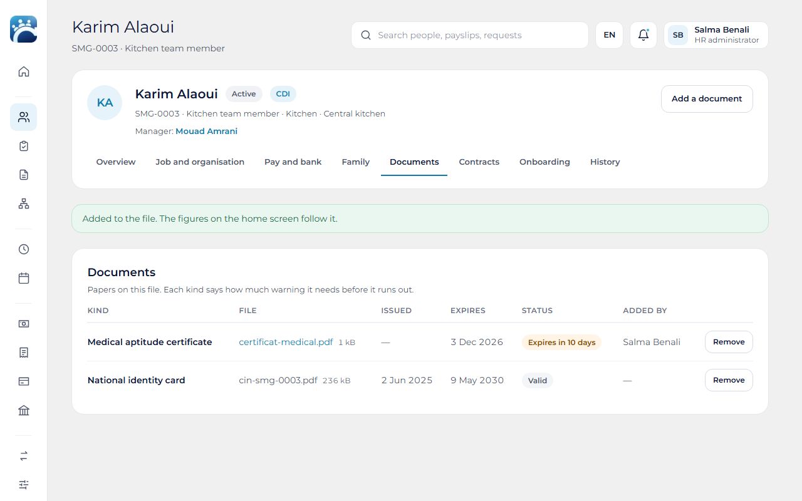


> "Every change is recorded — who, when, what it was before. A manager looking at
> this same history sees that the salary changed and not what it changed to.
> And the figures on the home page are live: one certificate uploaded, and the
> number that tells HR what to chase moves with it."

### ❓ Ask SMG

> **"Which documents do you keep in an employee file, and which of them do you
> need to be warned about before they expire?"**

### If it fails

- **The upload is refused:** it only takes PDF, JPEG or PNG, up to 10 MB. Any PDF
  on the laptop will do — have one ready on the desktop.
- **The figure does not change:** reload the home page once. The number is read
  when the page loads.
- **You edited the wrong thing:** it does not matter. Say so, and carry on — the
  history showing a mistake is a feature. `pnpm demo:reset` cleans it later.

---

## Scene 3 · Organisation and the org chart — 14:05

**Window: HR Salma** (reading). Use **Admin Amina** if you want to change a cost
centre — see the note below.

| Click | What appears |
|---|---|
| **Settings** → **Organisation** | The five departments, with their site, cost centre, head and headcount |
| The **Cost centres** tab | The cost centres, with the SAP column tagged **"To map with Finance"** |
| The **Cost-centre mapping** tab | One row per department, each marked "In order" or flagged |
| **Organisation chart** in the left menu, then choose **Kitchen** in the Department box and click **Find a person** | Rachid Kettani at the top of the kitchen, his supervisors under him, their teams under them |

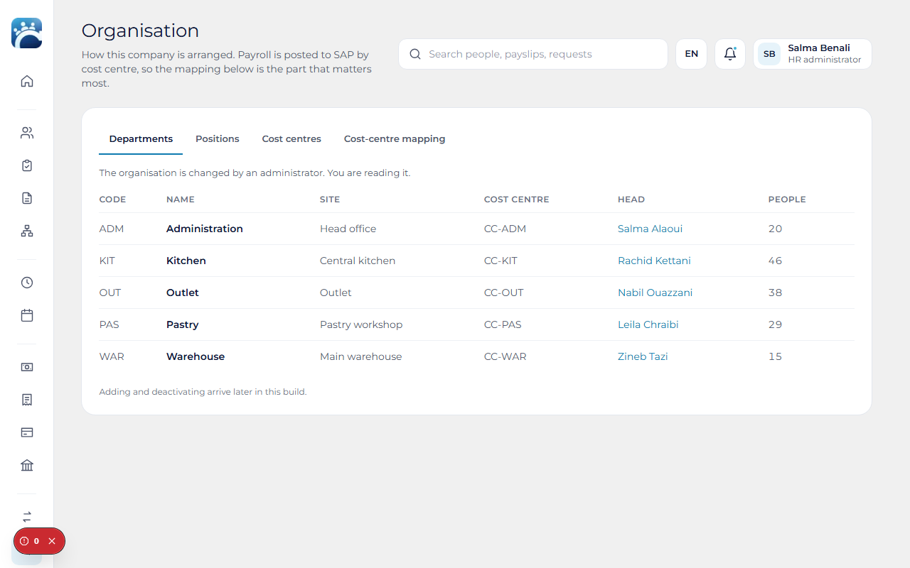

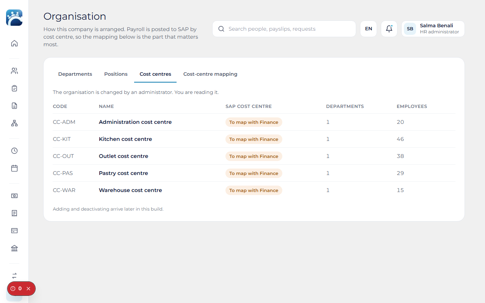

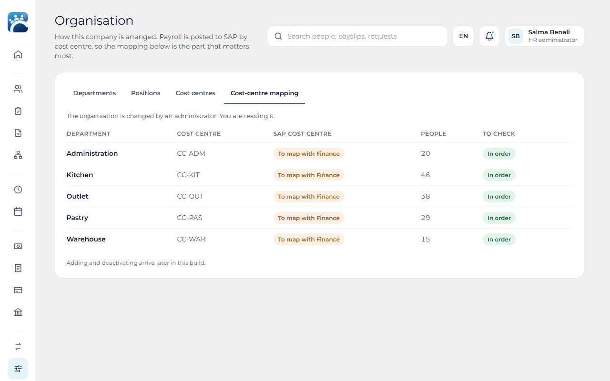

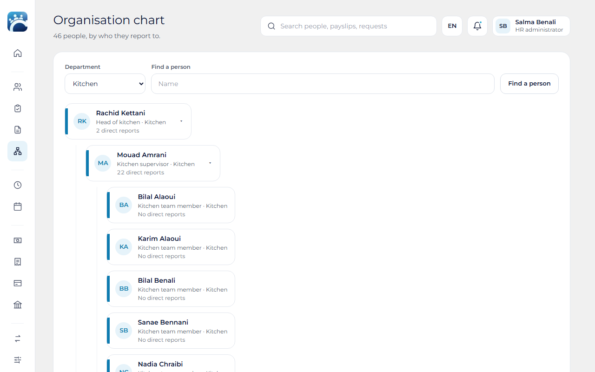

> "Payroll is posted to SAP by cost centre, so this mapping is the part that
> decides where the money lands. The SAP column is deliberately empty — those
> codes are yours to give us."

**If you want to show a change being made:** switch to the **Admin Amina**
window, Settings → Organisation → **Cost-centre mapping** → **Change** on
Kitchen. Choosing a different cost centre asks *"Apply to 46 people?"* before
anything moves, and the change lands in the audit log. In today's build HR can
read the organisation and an administrator changes it — **that split is itself a
question for SMG.**

### ❓ Ask SMG

> **"Which departments and cost centres do you want, and who are the HR users and
> the managers — N+1 and N+2?"**

### If it fails

- **The org chart is slow to open:** it draws all 148 people. Give it a second,
  or filter to Kitchen first.
- **No "Change" button:** you are in Salma's window. That is correct — switch to
  Amina's.

---

## Scene 4 · Hiring, and the contract — 14:15

**Window: HR Salma.** This is the longest scene. Say what you are doing as you
type; nobody minds a wizard taking a minute.

| Click | What appears |
|---|---|
| **Employees** → **New employee** (top right of the list) | Step 1 of 6, "Identity" |
| First name `Yasmine`, last name `Haddad`, date of birth `12/04/2001`, CIN `BK123456` → **Next** | Step 2, "Job" |
| Position **Kitchen team member**; Start date `01/12/2026` → **Next** | Step 3, "Pay and bank". The department and site filled themselves in |
| Base salary `4200` → **Next** → **Next** (no dependents) | Step 5, "Contract" |
| Kind of contract **Contrat à durée déterminée (CDD)**; Ends on `31/05/2027` → **Next** | Step 6, "Review" |
| **Create the employee** | Her file opens, status **Onboarding**, with a green line saying what to do next |

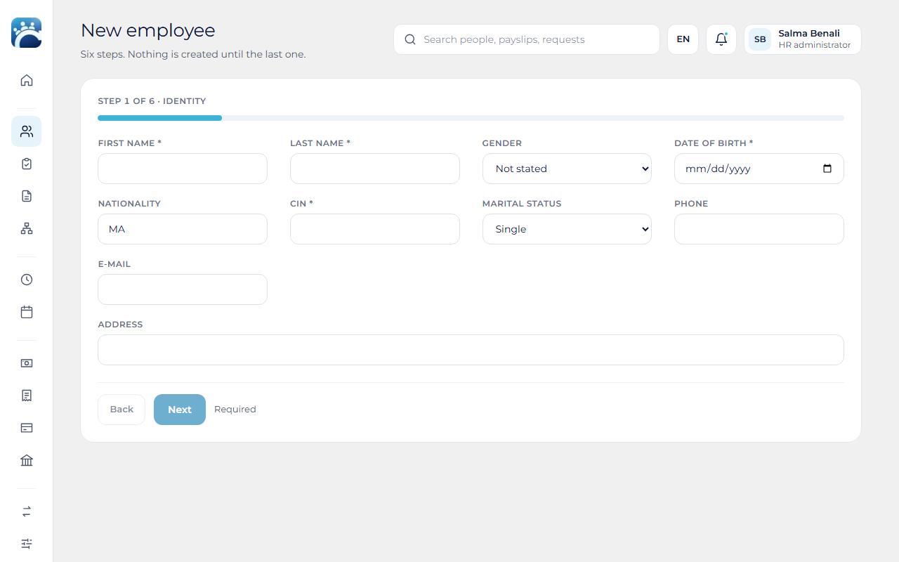

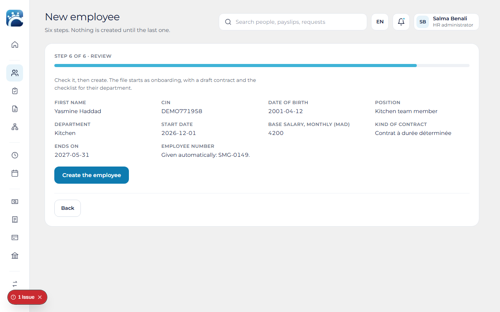

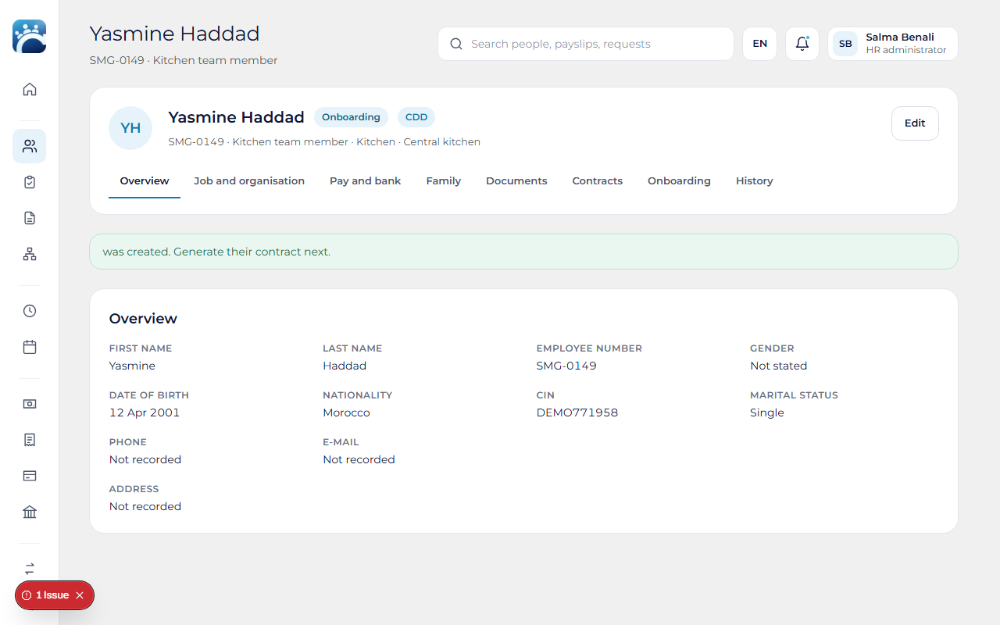

Then the contract:

| Click | What appears |
|---|---|
| The **Contracts** tab on her file, then the contract | The merge data on the left, the clauses on the right |
| **Generate the PDF** | "Generated." and a file name like `Contrat_CDD_SMG-0149_20261123.pdf` (her own matricule) |
| **Documents** tab → click the PDF | The contract opens in a new tab: French text, the clauses, signature blocks, and **MODÈLE – DÉMONSTRATION** across every page |
| Back on the contract, under "Mark it signed": choose any PDF → **Mark it signed** | "Signed. The onboarding item has been ticked." |
| The **Onboarding** tab | Eight tasks grouped by who does them. "Generate and sign the contract" is already ticked |
| **Mark done** on each remaining task, then **Make this file active** | Status changes from Onboarding to **Active** |

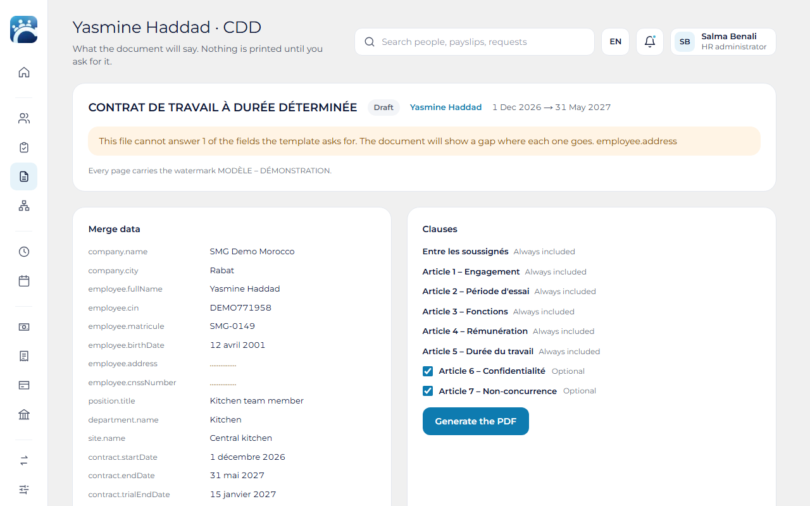

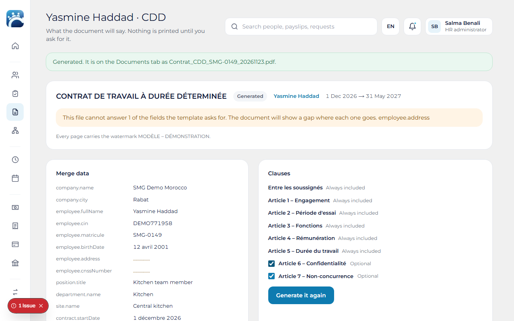

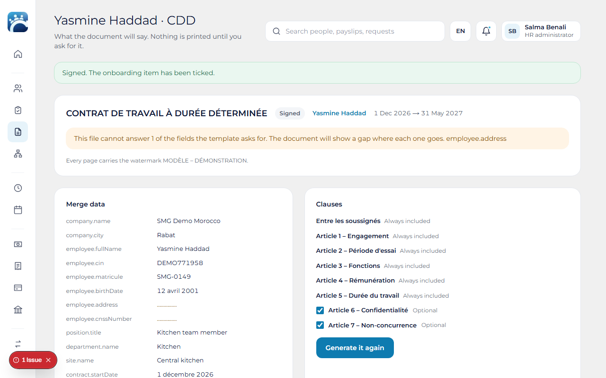

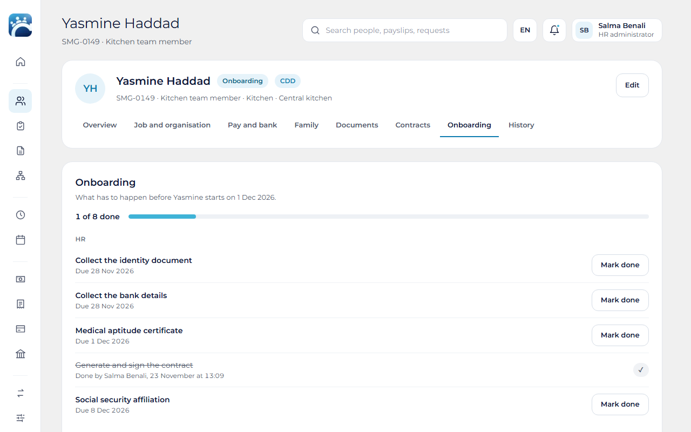

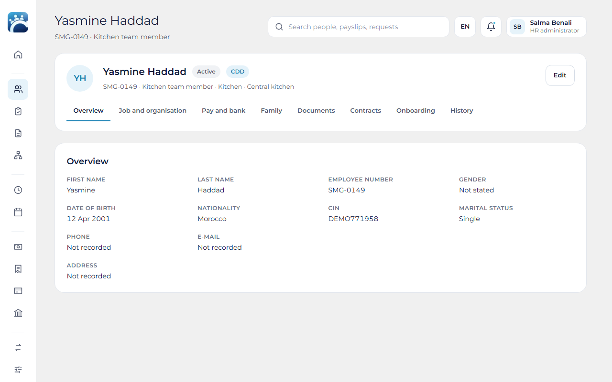

> "The contract text is a sample. Every clause is tagged 'à valider par SMG', and
> every page carries a watermark, so nobody can mistake it for the real thing —
> replacing that text with your own is part of the work. What is real is the
> machinery: the merge fields, the optional clauses, the PDF, and the checklist
> that will not let a file go Active until the required things are done."

### ❓ Ask SMG

> **"Which contract types do you use — CDI, CDD, ANAPEC, anything else — and
> whose templates and clauses should we start from?"**

### If it fails

- **"Another employee already has that CIN":** change a digit and carry on. That
  refusal is worth pointing at — it is the system protecting you.
- **The PDF takes a few seconds:** it is being produced for real. Keep talking.
- **The PDF does not open:** the document is still filed on the Documents tab;
  open it from there.
- **You cannot finish the checklist in time:** leave it. Say the file stays in
  Onboarding until the list is done, which is the point.

---

## Scene 5 · A fixed term ending — 14:30

**Window: HR Salma.**

| Click | What appears |
|---|---|
| **Home** | "Waiting for you" shows **Omar Chraibi, fixed-term contract ends** |
| Click that row's button | His contract, with Renew and End |
| Under **Renew**, set the new end to `31/05/2027` → **Renew** | "Renewed." and a new **draft** contract starting **1 Dec 2026** |
| **Home** again | Omar has gone from "Waiting for you" |


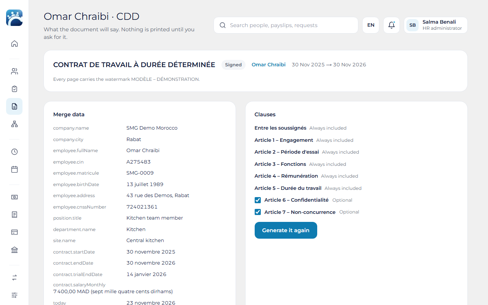

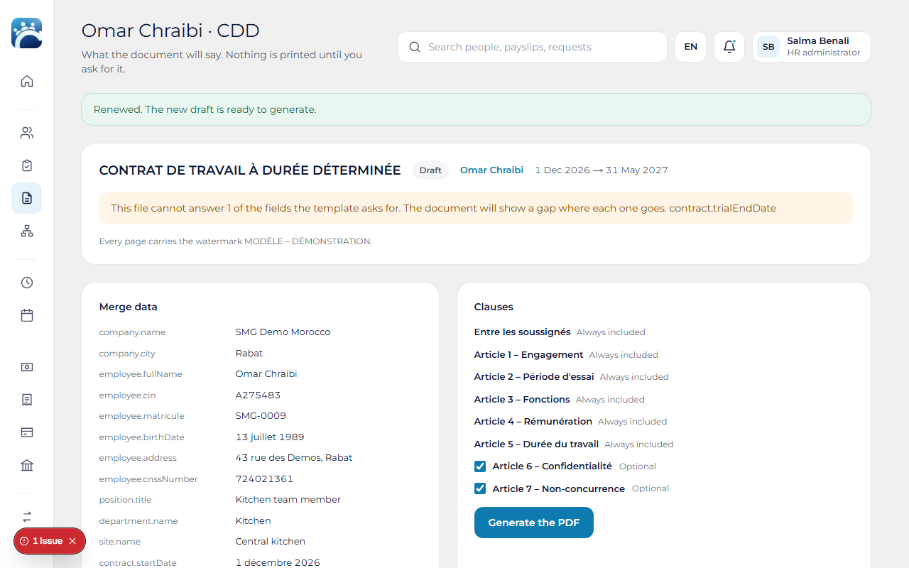


> "The home page is a to-do list, not a dashboard: it only shows what somebody
> has to act on, and the item disappears when it is dealt with. Note the line
> above the button — how many times a fixed term may be renewed is a legal
> question, and we will not guess it in software. That is one for your HR."

### ❓ Ask SMG

> **"How many times can a CDD be renewed in your practice, and who signs off a
> renewal?"**

### If it fails

- **Omar is not in "Waiting for you":** the rehearsal already renewed him. Run
  `pnpm demo:reset` (ten seconds) and reload. Or open **Contracts** → **Ending
  in 30 days** and use whoever is there.

---

## Scene 6 · The employee data template — 14:40 → **SKIP TODAY**

**This is not built yet.** Download and import of the Excel template is the next
piece of work. Do not open anything and do not promise a date from the stage.

**What to do instead — talk it through, 10 minutes, no screen:**

1. Open the **employee file** you already have on screen (Scene 2) and walk the
   tabs as the column list: identity, job and organisation, pay and bank, family,
   documents.
2. Say plainly what we need from SMG: one spreadsheet per employee with those
   fields, and that **we will send the template** with a read-me sheet, an
   example row and drop-down lists for departments, sites and contract types.
3. Agree **who fills it in** and **by when** — that is the decision that matters,
   and it is on the decisions page.

> "The template itself is being built this week. What we need from you today is
> not the file — it is the answer to who fills it in and by when, and whether any
> of those fields are wrong for SMG."

### ❓ Ask SMG

> **"Who fills in the employee data template, and is it due 15 December or 31
> December?"**

---

## The five decisions to get from SMG

Write the answers down during the meeting. These are the ones the project needs.

| # | Decision | Why it matters |
|---|---|---|
| 1 | **Will SMG use SuccessFactors Employee Central?** | It is out of scope today. A feed between the two would be a change request, and we would need to know now. |
| 2 | **Which contract types, and whose templates and clauses?** | CDI, CDD, ANAPEC — and the real text. Everything in the demo is sample text tagged "à valider par SMG". |
| 3 | **Which departments and cost centres? Who are the HR users and the managers (N+1, N+2)?** | Payroll is posted to SAP by cost centre; the mapping screen is empty until SMG gives us the codes. |
| 4 | **Which documents are kept in the employee file, and which need expiry tracking?** | Drives the "documents expiring" figure and the notice period for each kind. |
| 5 | **Who fills in the employee data template, and is it due 15 or 31 December 2026?** | The agreement gives both dates (Annex 2 and Article 5.5). It needs settling today. |

Plus the one from Scene 1: **two-step sign-in for everyone, or for Admin and HR
only?**

---

## If something goes wrong

### Docker is not running

Symptom: `pnpm demo:check` says several things are `DOWN`, or the home page will
not load at all.

1. Open **Docker Desktop** from the Start menu and wait until the whale in the
   system tray stops animating.
2. In the terminal: `pnpm demo:up`
3. Wait a minute, then `pnpm demo:check` until it is all green.

This is the most common morning problem — Windows restarts overnight and Docker
comes back asleep.

### "Port already in use"

Symptom: `pnpm demo:start` prints `EADDRINUSE: address already in use :::3000`
(or `:::3100`).

Something from an earlier session is still running. First, just check
`http://localhost:3000` in a browser: if CPeople is there, you do not need to
start anything — carry on.

Otherwise close the other terminal window and run `pnpm demo:start` again. If you
cannot find it, end it by hand:

```
netstat -ano | findstr :3000
taskkill /PID <the number at the end of that line> /F
```

then `pnpm demo:start` again.

### A window has signed itself out

Sign it back in with the accounts table at the top. It takes fifteen seconds. If
it keeps happening, run `pnpm demo:prepare` — sessions are then good for four
hours.

### Resetting in the middle of the demo

Safe, and quick (about ten seconds). In the second terminal:

```
pnpm demo:reset
```

It takes about half a minute. Then reload each window (F5). Everything goes back
to 148 people, Omar's contract ending on 30 November, five documents expiring.
Anything you created during the meeting disappears — which is usually what you
want after a scene has gone sideways.

You do **not** need to sign in again after a reset.

### The figures show "—" instead of numbers

The API lost its connection for a moment. Reload the page. If it persists, look
at the first terminal for a red error, and run `pnpm demo:check`.

### Something is broken and you cannot fix it

Say so plainly, move to the next scene, and offer to show it after the meeting.
Every scene stands on its own — nothing later depends on an earlier one, except
that Scene 4 and 5 both want the data reset if you have already rehearsed them.

---

## After the meeting

```
pnpm demo:restore
```

Puts two-step sign-in back on for the Admin, HR and Payroll roles, and session
timeouts back to 30 minutes. Then close the terminal windows.

The answers to the five decisions go to the project lead the same day.
