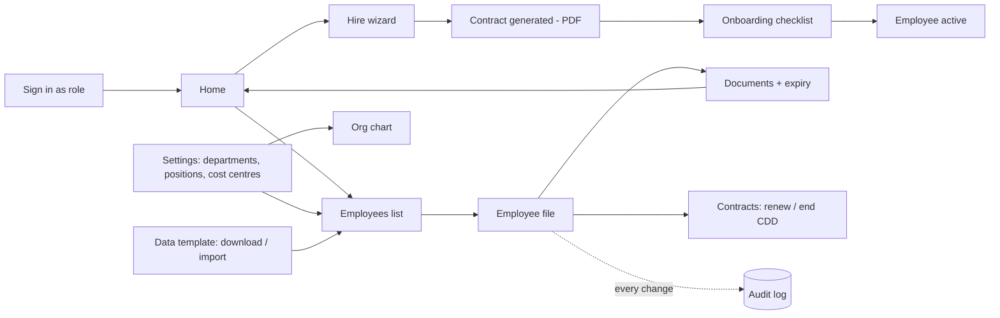
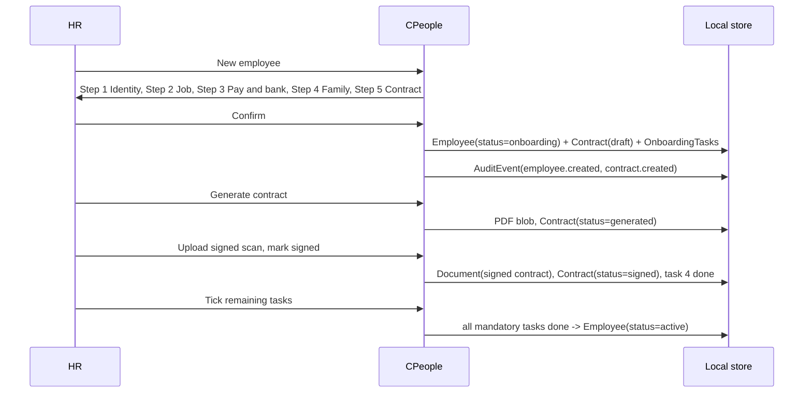
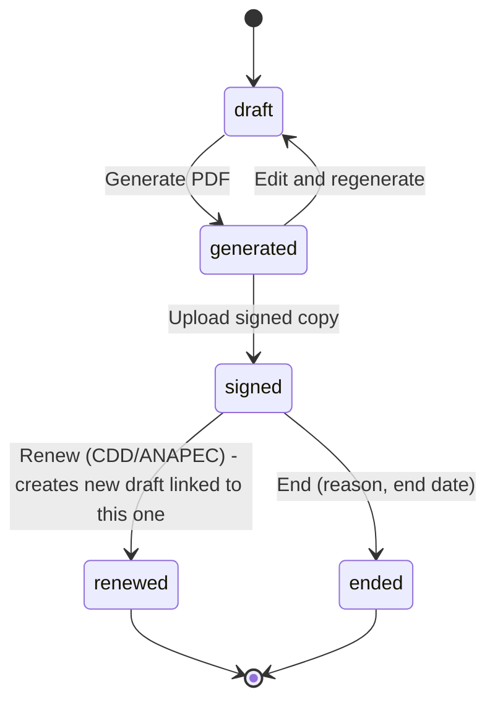

# CPeople by ConSAP – Build spec for the HR-01 demo

**Hand-off to Claude Code** · Written Sun 22 Nov 2026 · Demo: **Mon 23 Nov 2026, 13:30 – 15:30**, workshop HR-01 at Maison Samira Maatouk (SMG), Rabat
**Topic of HR-01:** employee files, organisation, contracts. Leave/attendance (HR-02, 24 Nov) and payroll/SAP posting (HR-03, 25 Nov) are **not** in this build.

---

## 0. Read this first

1. **Goal for Monday:** an HR manager can open CPeople from a web link, sign in as a role, and **really** do these things on screen: find an employee, open and edit the employee file, hire a new employee through a wizard, generate a contract (CDI, CDD, ANAPEC) as a PDF, track an onboarding checklist, attach documents with expiry dates and see the alerts, manage departments / positions / cost centres, see the organisation chart, switch roles to show what each role can see, see the audit log, and download/import the employee data template.
2. **Demo data only.** Every person, ID, CNSS number, bank account and salary is invented. Never load real SMG employee data into this build. SMG is the data controller under Moroccan Law 09-08; real data arrives only after the data template is agreed at HR-01.
3. **No backend needed for Monday.** Build a front-end app with a local data store (IndexedDB) seeded with demo data, plus a **Reset demo data** button. Everything must work offline once loaded.
4. **Do not claim what is not built.** The demo has a role switcher, not real sign-in or encryption. Security features from the product design (personal sign-in, encrypted data, separate data per client) are presented on a slide, not demoed.
5. **UI language: English.** Contract documents are generated in **French** (sample text, marked "à valider par SMG").
6. **Priorities:** every item is tagged **P0** (must work Monday), **P1** (should work), **P2** (only if time is left). Section 9 has the cut line.

---

## 1. What exists today (audit of `CPeople___Home_dashboard.html`)

The file is a **design-canvas export**, not an app: a generic `dc-runtime` script renders an `<x-dc>` template (`sc-if`, `sc-for`, `{{…}}` bindings) driven by one `class Component extends DCLogic` with `renderVals()`. React 18 UMD, Montserrat (Google Fonts, OFL) and three PNG logos are packed inside as base64.

| Area | What is there | Works? |
|---|---|---|
| Sidebar rail | Collapsed icons, expands on hover/focus, pin button, mobile drawer with scrim | **Yes** (local state only) |
| Nav groups | Home · People: Employees, Onboarding, Contracts, Organisation chart · Time: Attendance, Leave (badge 7) · Pay: Payroll, Payslips, Expenses (badge 3), Declarations · Company: SAP posting, Settings | **No** – all `href="#"` |
| Company card | "Demo Company – Rabat, Morocco pack" | Static |
| Header | "Good morning, Salma", date hard-coded "Wednesday 18 November 2026", search box, EN button, notifications (dot), account "Salma Benali – HR manager" | **No** |
| Hero | November 2026 payroll, 4 figures (MAD), 7-step run tracker, 2 buttons | Static, buttons dead |
| KPI tiles | Headcount 148, Present 41/42, Leave 7 pending, Documents expiring 5 | Static, links dead |
| Waiting for you | 5 actions (holiday premium, leave N+2, expenses, **CDD ends – Omar Chraibi**, attendance punches) | Static, buttons dead |
| Away this week | Week strip + 4 people; "Today is Independence Day" | Static |
| Payroll cost chart | 12-month spline, hover tooltip | **Yes** (hover only) |
| Headcount by department | Kitchen 46, Outlet 38, Pastry 29, Administration 20, Warehouse 15 = 148; "12 on fixed-term contracts" | Static |
| Declarations and connections | SAP S/4HANA, CNSS Damancom, IR, Attendance devices | Static |

**Keep:** the visual design, palette, spacing, icon paths (the `I` object), logos, responsive behaviour, focus styles, `prefers-reduced-motion` handling.
**Fix:** everything is hard-coded; no routing; no data model; no other screens.

Small issues to fix while porting:
- Amounts use `1,284,650.00`. Use one formatter for the whole app: **`1 284 650,00 MAD`** (space as thousands separator, comma decimal) – or keep dot decimals, but be consistent everywhere.
- The date and "Today is Independence Day" are hard-coded. Drive both from a **demo clock** (section 3.4) and a public-holiday table.
- Accent colour `#3FB3D7` vs ConSAP Sky `#3FAAD8`: pick one token and use it everywhere.

---

## 2. Target architecture (for the demo)

| Layer | Choice | Why |
|---|---|---|
| App | **Vite + React 18 + TypeScript** single-page app | Fast to build; if the homepage source already exists in another stack, keep that stack and apply the same structure |
| Routing | React Router (hash routing, so it works from a static host or a file) | |
| State + data | IndexedDB via `idb` or Dexie; one repository module per entity | Survives refresh; works offline |
| Files | Documents and generated PDFs stored as Blobs in IndexedDB | No server |
| PDF | `pdfmake` or `@react-pdf/renderer` for contracts | Client-side |
| Excel | `SheetJS (xlsx)` for the data template download and import | |
| Styling | Port the existing inline styles into CSS modules or a small token file (`tokens.css`) | |
| Hosting | Static build on a ConSAP-controlled web link **plus** a local copy on the presenter's laptop (`npm run preview`) | Meeting-room network is unknown |

**Port the homepage first** (P0): rebuild the existing home in the new app, pixel-close, with the data coming from the store instead of constants (section 6.12).

### 2.1 Routes

| Route | Screen | Priority |
|---|---|---|
| `/#/` | Home (HR manager) | P0 |
| `/#/employees` | Employee list | P0 |
| `/#/employees/new` | Hire wizard | P0 |
| `/#/employees/:id` | Employee file (tabs) | P0 |
| `/#/contracts` | Contracts list | P0 |
| `/#/contracts/:id` | Contract detail and PDF preview | P0 |
| `/#/onboarding` | Onboarding board | P1 |
| `/#/org` | Organisation chart | P0 |
| `/#/settings/organisation` | Departments, positions, cost centres | P0 |
| `/#/settings/contract-templates` | Contract types and templates | P1 |
| `/#/settings/document-types` | Document types and expiry rules | P1 |
| `/#/settings/roles` | Roles and permission matrix (read-only view) | P0 |
| `/#/settings/audit` | Audit log | P0 |
| `/#/settings/data` | Data template download / import, Reset demo data | P0 |
| `/#/leave`, `/#/attendance`, `/#/payroll`, `/#/payslips`, `/#/declarations`, `/#/sap-posting` | "Coming in workshop HR-02 / HR-03" empty state | P0 (empty state only) |
| `/#/expenses` | **Hide from the nav** (expense claims are not in SMG's scope) | P0 |

---

## 3. Data model

All IDs are UUIDs. All entities carry `createdAt`, `createdBy`, `updatedAt`, `updatedBy`. Every change writes an `AuditEvent`.

### 3.1 Organisation

```ts
Company     { id, name: "Demo Company", city: "Rabat", country: "MA", currency: "MAD" }
Site        { id, code, name }  // Outlet (Rabat), Main warehouse, Kitchen, Pastry, Head office
CostCentre  { id, code, name, sapCostCentre?: string /* to be mapped with Finance (HR-03) */, active }
Department  { id, code, name, siteId, costCentreId, headEmployeeId? }
Position    { id, code, title, departmentId, reportsToPositionId?, headcountPlanned? }
```

Seed: departments **Kitchen, Outlet, Pastry, Administration, Warehouse** (they match the home page counts). Cost-centre codes are **demo codes** (e.g. `CC-KIT`, `CC-OUT`) with the column "SAP cost centre" left empty and labelled "to map with Finance".

### 3.2 Employee file (fields from the agreement, Annex 1 C1, plus what the screens need)

```ts
Employee {
  id, matricule /* unique, e.g. SMG-0001 */,
  status: "onboarding" | "active" | "left",
  // Identity
  firstName, lastName, gender, birthDate, nationality,
  cin /* national ID; or passport / residence permit for foreign staff */,
  maritalStatus, address, phone, email /* used later to send payslips */,
  // Job
  positionId, departmentId (derived from position, editable), siteId, costCentreId (default from department),
  managerId /* N+1 */, hireDate, seniorityDate,
  // Contract summary (mirrors the current Contract)
  currentContractId, contractType, contractEndDate?,
  // Pay basics (captured now, used in HR-03)
  baseSalaryMonthly /* MAD */, cnssNumber, cimrMember: boolean,
  // Bank
  bank: { bankName, rib /* 24 digits */ },
  // Family
  dependents: Dependent[]
}
Dependent { id, employeeId, relation: "spouse" | "child", firstName, birthDate }
```

Validation (P0, show inline errors):
- Required: matricule, first name, last name, CIN, birth date, hire date, position, department, cost centre, contract type.
- Unique: matricule, CIN, CNSS number.
- RIB: 24 digits (warning, not blocking, in the demo).
- CNSS number and CIN formats: **configurable regex in Settings, warning only.** Exact formats are to be confirmed with SMG; do not hard-block.
- Hire date ≤ today + 90 days; birth date gives age ≥ 15 (warning).

**Sensitive fields:** `cin`, `cnssNumber`, `baseSalaryMonthly`, `bank.*`, `dependents`, `birthDate`, `address`. They follow the role rules in section 5.

### 3.3 Contracts, documents, onboarding, users, audit

```ts
ContractType     { id, code: "CDI" | "CDD" | "ANAPEC" | string, name, requiresEndDate, defaultTrialDays?, templateId }
ContractTemplate { id, contractTypeId, language: "fr", version, body /* text with {{merge.fields}} and clause blocks */, clauses: Clause[] }
Clause           { id, key, title, text, mandatory: boolean }
Contract         { id, employeeId, contractTypeId, templateVersion, startDate, endDate?, trialEndDate?,
                   positionId, salaryMonthly, workplaceSiteId,
                   status: "draft" | "generated" | "signed" | "ended" | "renewed",
                   pdfBlobId?, signedDocumentId?, previousContractId?, endReason? }
DocumentType     { id, code, name, requiresExpiry: boolean, alertDaysBefore: number, sensitive: boolean }
Document         { id, employeeId, documentTypeId, fileName, mime, blobId, issueDate?, expiryDate?, uploadedBy, note? }
ChecklistTemplate{ id, name, appliesTo: { contractTypeIds?: string[], departmentIds?: string[] }, items: ChecklistItemTemplate[] }
ChecklistItemTemplate { id, title, ownerRole: Role, dueOffsetDays: number /* from hire date, may be negative */, requiresDocumentTypeId? }
OnboardingTask   { id, employeeId, templateItemId, title, ownerRole, dueDate, status: "todo" | "done", doneAt?, doneBy?, documentId? }
User             { id, name, role: "admin" | "hr" | "manager" | "employee", employeeId? }
AuditEvent       { id, at, userId, role, action, entity, entityId, summary, diff?: { field, from, to }[] }
PublicHoliday    { date, name }
```

Seed document types: CIN copy (expiry), residence permit (expiry, alert 60 days), medical aptitude certificate (expiry, alert 30 days), RIB certificate, diploma, signed contract, CNSS affiliation proof, photo.

Seed contract types: **CDI**, **CDD** (end date required), **ANAPEC** (insertion contract; end date required). All template text is **sample French text**, and every clause carries the tag `[Clause type – à valider par SMG]`.

Seed checklist ("New hire – all"), with sample items to confirm at HR-01:
1. Collect CIN copy (HR, −3 days) → document CIN copy
2. Collect RIB (HR, −3) → document RIB certificate
3. Medical aptitude certificate (HR, 0) → document medical certificate; **kitchen and pastry only**
4. Generate and sign contract (HR, 0) → signed contract
5. CNSS affiliation (HR, +7) → document CNSS proof
6. Create CPeople access for the employee (Admin, 0)
7. Hygiene and safety induction (Manager, +2); **kitchen and pastry only**
8. Uniform and badge (Manager, 0)

### 3.4 Demo clock

A `today()` function used **everywhere** (never `new Date()` directly). Default **23 Nov 2026**. Settings can change it, so the presenter can show the "CDD ends this week" and "documents expiring" scenarios.

### 3.5 Seed data (P0)

A deterministic generator (fixed random seed) that creates:
- **148 employees**: Kitchen 46, Outlet 38, Pastry 29, Administration 20, Warehouse 15. **12 on CDD**, 3 on ANAPEC, the rest CDI. Invented Moroccan-style names, invented CIN / CNSS / RIB in the right shape. Salaries invented and rounded to 100 MAD.
- A manager tree: General manager → department heads → supervisors → staff, so the org chart has 3 to 4 levels.
- **Named demo characters**, kept from the homepage so the home stays coherent:
  - Salma Benali – HR manager (user, role HR)
  - Karim Alaoui, Leila Fassi, Mehdi Idrissi, Sara Amrani, Yassine Tazi, Nadia Berrada – staff
  - **Omar Chraibi – CDD ending 30 Nov 2026** (drives the renew/end scenario)
- Documents: about 5 expiring within 30 days of the demo clock (2 residence permits, 3 medical certificates, as the home shows), a few already expired, most valid.
- 2 employees in status `onboarding`, with checklists half done (hire date 1 Dec 2026).
- Public holidays 2026 (at least 18 Nov Independence Day, plus the other fixed national holidays).
- Users: Admin (ConSAP admin), HR (Salma Benali), Manager (a Kitchen head, e.g. "Rachid Kettani"), Employee (e.g. "Karim Alaoui").

---

## 4. End-to-end process flows

### 4.1 Overview



### 4.2 Hire-to-active flow



### 4.3 Contract lifecycle



---

## 5. Roles and permissions (P0)

A **role switcher** in the account menu (top right) changes the current user. The whole UI re-renders: nav, fields, buttons. This is how the presenter shows roles at 13:30.

| Capability | Admin | HR | Manager (N+1) | Employee |
|---|---|---|---|---|
| See employee list | All | All | **Own team only** | – |
| See sensitive fields (CIN, CNSS, salary, bank, dependents, birth date, address) | Yes | Yes | **Masked** (`•••• 1234`) | Own file only |
| Create / edit employee | Yes | Yes | – | Edit own phone, address, email only (P2) |
| Generate / end / renew contract | Yes | Yes | – | – |
| Upload documents | Yes | Yes | – | Own documents (P2) |
| Onboarding tasks | All | All | Tasks with owner Manager, own team | – |
| Settings: organisation, templates, document types | Yes | View | – | – |
| Data template import | Yes | Yes | – | – |
| Audit log | Yes | View | – | – |
| Reset demo data, demo clock | Yes | – | – | – |

Rules:
- Enforce in **one place** (`can(user, action, resource)`), used by routes, buttons and field renderers.
- A masked field is never put in the DOM unmasked. Do not just hide it with CSS.
- The proposed matrix is itself a topic for HR-01: put a banner "Proposed – to confirm with SMG" on `/settings/roles`.

---

## 6. Screens and process steps, one by one

Each block lists: **what the user does → what the system does → acceptance criteria (AC)**.

### 6.1 Role switcher and session (P0)
- Account button → menu shows the 4 demo users with role names → select one.
- System: sets the current user, writes `AuditEvent(session.role_switched)`, navigates to the role's home (Employee → own file; Manager → team list; HR/Admin → Home).
- AC: switching to Manager hides Settings and the salary and bank fields everywhere; switching back restores them.

### 6.2 Employee list (P0)
- Table: photo/initials, name, matricule, position, department, site, contract type (pill), contract end, status, documents status (dot: OK / expiring / expired).
- Search (name, matricule, CIN for HR); filters: department, site, contract type, status, "documents expiring", "CDD ending in 30 days".
- Sort by name, hire date, contract end. Pagination or virtual scroll (148 rows).
- Buttons: **New employee**, **Download list (xlsx)** (HR/Admin; respects masking).
- AC: the home KPI "Documents expiring" opens this list pre-filtered, and the count matches.

### 6.3 Employee file (P0)
Header: name, matricule, position, department, status pill, contract pill, manager link, quick actions (Edit, Generate contract, Upload document).
Tabs:
1. **Overview** – identity, job, contacts; seniority computed from the seniority date.
2. **Job and organisation** – position, department, site, cost centre (default from department, can override; show "overridden" tag), manager.
3. **Pay and bank** – base salary, CNSS number, CIMR member, bank and RIB. Masking per role. Note on the tab: "Used by payroll – workshop HR-03".
4. **Family** – dependents table (add/edit/remove).
5. **Contracts** – history list with status, dates, PDF link; actions per section 6.6.
6. **Documents** – section 6.7.
7. **Onboarding** – section 6.8 (only when there are tasks).
8. **History** – audit events for this employee, newest first, with field-level diffs.

Edit mode: same layout with inputs, Save / Cancel, inline validation, unsaved-changes guard. Save writes the field diffs to the audit log.
AC: edit the salary of an employee → History shows `baseSalaryMonthly: 6 500,00 → 7 000,00` with user, role and time. As Manager, the History entry shows the field name but masked values.

### 6.4 Hire wizard (P0)
Steps with a progress bar, Back / Next, and a draft kept between steps:
1. **Identity**: name, gender, birth date, nationality, CIN, marital status, address, phone, email.
2. **Job**: position (picker filtered by department) → department, site, cost centre and manager pre-filled; hire date.
3. **Pay and bank**: base salary, CNSS number (can be "pending affiliation"), CIMR member, bank, RIB.
4. **Family**: dependents (optional).
5. **Contract**: contract type → if CDD/ANAPEC, end date required; trial period end (default from contract type); work location; salary copied from step 3.
6. **Review**: a summary with edit links per step → **Create employee**.

System on create: generates the matricule (next number), Employee(status `onboarding`), Contract(`draft`), onboarding tasks from the matching checklist template(s) with due dates from the hire date, audit events. Then it goes to the employee file with a toast "Employee created – generate the contract next" and a button.
AC: duplicate CIN → blocking error on step 1 with a link to the existing employee.

### 6.5 Organisation (P0)
`/settings/organisation`, 3 tabs, each a table with Add / Edit / Deactivate (no delete if referenced):
- **Departments**: code, name, site, cost centre, head (employee picker), headcount (computed).
- **Positions**: code, title, department, reports to (position), planned headcount, filled (computed).
- **Cost centres**: code, name, **SAP cost centre** (free text, empty in the demo, tag "map with Finance"), number of departments, number of employees.

Also a **Department → cost centre mapping** view: one row per department, with a warning when a department has no cost centre or when employees override it.
AC: change Kitchen's cost centre → existing Kitchen employees without an override follow it (ask "Apply to 46 employees?") and the audit log records it.

### 6.6 Contracts (P0)
**List** `/contracts`: employee, type, start, end, status, days to end; filters: type, status, "ending in 30 days".

**Generate** (from the employee file or the wizard result):
1. Choose the contract (draft) → preview screen: left, the merge data with "missing" warnings; right, the rendered document.
2. Optional clauses: tick or untick non-mandatory clauses.
3. **Generate PDF** → stored, status `generated`, download and print buttons, file name `Contrat_<TYPE>_<matricule>_<YYYYMMDD>.pdf`.

Merge fields (at least): `{{company.name}}`, `{{company.city}}`, `{{employee.fullName}}`, `{{employee.cin}}`, `{{employee.birthDate}}`, `{{employee.address}}`, `{{employee.cnssNumber}}`, `{{position.title}}`, `{{department.name}}`, `{{site.name}}`, `{{contract.startDate}}`, `{{contract.endDate}}`, `{{contract.trialEndDate}}`, `{{contract.salaryMonthly}}` (in figures and in French words), `{{today}}`.
PDF layout: company block, title (e.g. "CONTRAT DE TRAVAIL À DURÉE INDÉTERMINÉE"), parties, numbered articles from the clauses, signature block for both parties, footer with page numbers. A watermark **"MODÈLE – DÉMONSTRATION"** on every page.

**Mark signed**: upload a scan (PDF/JPG) → stored as Document type "Signed contract" → contract `signed` → the onboarding task "Generate and sign contract" is ticked.

**Renew** (CDD/ANAPEC, P0 because the home shows Omar Chraibi): new start = old end + 1 day; enter a new end date → new draft linked by `previousContractId`; old one becomes `renewed`. Show a non-blocking notice: "Check renewal limits for this contract type with SMG HR."
**End**: end date + reason (end of term, resignation, dismissal, other) → contract `ended`; if no other active contract, employee `left` on that date (P1: exit checklist).
AC: from Home, "Omar Chraibi – CDD ends 30 Nov – Prepare" opens his contract with Renew / End buttons; renewing it removes the item from "Waiting for you".

### 6.7 Documents and expiry (P0)
- Employee file → Documents tab: table (type, file name, issue date, expiry date, status pill **Valid / Expires in N days / Expired**, uploaded by) and an upload button (drag and drop; type picker; dates; expiry required when the type requires it).
- Preview (PDF/image) in a side panel; download; replace (keeps the previous version, P1).
- Status rule: `expired` if expiry < today; `expiring` if expiry ≤ today + `alertDaysBefore`; else `valid`.
- The home KPI "Documents expiring", the notifications and the list filter all use the **same** function.
- Upload size limit 10 MB; types PDF, JPG, PNG.
AC: upload a medical certificate with an expiry 10 days after the demo clock → the KPI goes up by one, a notification appears, and the employee row shows an orange dot.

### 6.8 Onboarding (P1; the employee-file tab is P0)
- Board `/onboarding`: one card per employee in status `onboarding` with progress (e.g. 3 / 8), next due task, late tasks in red.
- Employee tab: task list grouped by owner role; tick done (records who and when); tasks needing a document open the upload with the type pre-selected and tick themselves when the document is saved.
- When all **mandatory** tasks are done → prompt "Mark employee as active?" → status `active`, audit event.
- Settings (P1): edit checklist templates (items, owner role, due offset, conditions by contract type and department).

### 6.9 Organisation chart (P0)
- Tree from `managerId` (people view) with a toggle to the positions view (P1).
- Card: initials, name, position, department colour band, number of direct reports; collapse/expand; zoom and fit; search jumps to the person.
- Filter by department; click a card → employee file (subject to role).
- Vacant positions (planned > filled) shown as dashed cards (P1).
- Export PNG/PDF (P2).
AC: 148 employees render smoothly; the Manager role sees only their own branch.

### 6.10 Employee data template: download and import (P0 – this is the HR-01 deliverable topic)
**Download** `/settings/data` → `CPeople_Employee_Data_Template_v0.1.xlsx`:
- Sheet **Read me**: purpose, how to fill it, which fields are required, formats, **"Use real data only after the template is agreed; send through the agreed secure channel."**
- Sheet **Employees**: one column per field in 3.2 (dependents as a count plus a separate sheet), header row frozen, required columns marked, **one example row** of invented data, data validation lists for department, site, contract type, gender, marital status.
- Sheet **Dependents**: matricule, relation, first name, birth date.
- Sheet **Lists**: allowed values (from the current settings).

**Import** (wizard):
1. Upload the xlsx.
2. Validation report per row: errors (block: missing required, duplicate matricule/CIN/CNSS, unknown department/position/cost centre, bad date) and warnings (RIB length, CNSS/CIN format, age).
3. Preview: X new, Y updates (matched by matricule), Z rows with errors; download the error report as xlsx.
4. **Import valid rows** → creates/updates employees, writes one audit event per employee plus one `import.completed` event with counts.
AC: import the template with the example row plus 2 bad rows → 1 imported, 2 errors listed with the column and the reason.

### 6.11 Audit log (P0)
- `/settings/audit`: table of time, user, role, action, entity, summary; filters: user, action, entity, date range; click a row → diff panel.
- Logged actions: role switch, employee create/update (field diff), contract create/generate/sign/renew/end, document upload/delete, task done, organisation changes, import, export/download of lists and templates, demo reset.
- Sensitive values in diffs are masked for roles that cannot see them.

### 6.12 Home, wired up (P0)
Port the existing home and replace the constants with selectors on the store:
- Greeting with the current user's first name; date from the demo clock; holiday line from `PublicHoliday` (on 23 Nov: no holiday, so show "No public holiday today").
- **KPIs**: Headcount (computed; note "N joined and M left this month"); Documents expiring (computed); Present today and Leave pending stay **static with a small "HR-02" tag**, or are replaced for HR-01 by **"Onboarding in progress"** and **"CDD ending in 30 days"** (recommended – both are live in this build).
- **Waiting for you**: generated from live data – CDD/ANAPEC ending within 14 days, onboarding tasks overdue, documents expired. Payroll/leave/expense items are removed or tagged HR-02/HR-03. Each **CTA opens the real object**.
- **Headcount by department**: computed; the sub-title "148 employees, 12 on fixed-term contracts" is computed.
- **Payroll hero, cost chart, Away this week, Declarations and connections**: keep as a **visual preview** with a discreet "Preview – workshop HR-03" (or HR-02) tag; their buttons show a tooltip "Shown in HR-03" instead of doing nothing.
- **Search** (header): live results grouped by Employees / Documents / Contracts; Enter opens the first; respects the role.
- **Notifications** bell: list built from the same rules as "Waiting for you"; the unread dot is real.
- **EN button**: shows "English" only (French/Arabic later); do not fake a translation.
- Every nav item routes somewhere (section 2.1). **Expenses hidden.**

### 6.13 Empty states for later modules (P0)
Leave, Attendance, Payroll, Payslips, Declarations, SAP posting: a clean page with the module icon, one sentence on what it will do (from the agreement: leave under Moroccan law with N+1/N+2 approval; attendance from devices by API or export file; payroll with CNSS, AMO, CIMR, IR; CNSS Damancom and IR data; journal entry posted to SAP S/4HANA by cost centre), and "Workshop HR-02, 24 Nov" or "Workshop HR-03, 25 Nov".

### 6.14 Settings → Demo (P0)
- **Reset demo data** (Admin): wipes IndexedDB and re-seeds; confirm dialog; audit event after the reset.
- **Demo clock**: date picker (default 23 Nov 2026).
- **Build info**: version, build date, "Demo build – invented data".

---

## 7. Non-functional requirements

- **Performance**: 148 employees, the org chart and the list must stay smooth on a mid-range laptop; first load < 3 s on 4G after deploy.
- **Offline**: once loaded, everything works without network (fonts bundled locally, not from Google Fonts at runtime).
- **Accessibility**: keep 44 px targets, visible focus rings, `aria-current` on nav, labels on all inputs, colour never the only signal (pills carry words).
- **Responsive**: the existing mobile layout (≤ 720 px) must still work on Home, the list and the employee file; the org chart can require desktop.
- **No external calls** with data: no analytics, no CDN at runtime, no error-reporting service.
- **Formatting**: dates "23 Nov 2026"; money "6 500,00 MAD"; one helper for each.
- **Code quality**: TypeScript strict; one module per entity (repository + selectors); `today()`; `can()`; `formatMAD()`; `formatDate()`; seed in `seed/`.

---

## 8. Demo script (what must run, minute by minute)

| Time | Agenda item (HR-01 deck) | What the presenter clicks | Depends on |
|---|---|---|---|
| 13:30 | CPeople overview: roles, access, data protection (Law 09-08) | Home as HR → role switcher → Manager (masked fields, team only) → Employee (own file) → back to HR → Settings › Roles (matrix) → Settings › Audit (the role switches just made are listed) | 5, 6.1, 6.11, 6.12 |
| 13:50 | Demo: employee file | Search "Karim" → employee file tabs → edit phone → History shows the diff → Documents: upload a medical certificate with a near expiry → KPI changes on Home | 6.2, 6.3, 6.7 |
| 14:05 | Demo: organisation | Settings › Organisation → departments with cost centres → Org chart → filter Kitchen → click a person | 6.5, 6.9 |
| 14:15 | Demo: hire + contract | New employee wizard (kitchen commis, CDD 6 months) → create → generate contract PDF → open PDF → upload "signed" scan → onboarding tasks tick → finish tasks → Active | 6.4, 6.6, 6.8 |
| 14:30 | Demo: CDD end | Home → "Omar Chraibi – CDD ends" → Renew → new draft | 6.6, 6.12 |
| 14:40 | SMG data today | Settings › Data → download the template → walk through the columns with Mr. Hassam (no real data on screen) | 6.10 |
| 15:10 | Decisions, data template, next steps | Show the import with the example row (dry run) | 6.10 |

**Rehearsal**: run the whole script twice after a **Reset demo data**, once on the hosted link and once on the local copy. Record a screen video of one full run as a backup.

---

## 9. Build order and cut line

Do these in order. Commit after each step. Run the smoke test (section 10) after steps 4, 8 and 12.

1. Project scaffold, tokens, fonts and logos bundled locally, app shell (rail, header) ported from the homepage. **P0**
2. Data layer: entities, repositories, `today()`, formatters, seed generator (148 employees + named characters), Reset. **P0**
3. Roles: users, role switcher, `can()`, masking component. **P0**
4. Home ported and wired to the store (6.12), all nav routes and empty states (6.13), Expenses hidden. **P0**
5. Employee list + search + filters (6.2). **P0**
6. Employee file, view and edit, with audit diffs (6.3, 6.11 core). **P0**
7. Documents tab with expiry logic and home/notification link (6.7). **P0**
8. Organisation settings + cost-centre mapping (6.5). **P0**
9. Org chart, people view (6.9). **P0**
10. Hire wizard (6.4) + onboarding tasks on the employee file (6.8 tab). **P0**
11. Contract generation, PDF, mark signed, renew/end (6.6). **P0**
12. Data template download + import with validation report (6.10). **P0**
13. Audit log screen with filters (6.11). **P0**
—— **Cut line: everything above must work on Monday at 12:00.** ——
14. Onboarding board, checklist template editor (6.8). P1
15. Contract template and document type settings screens. P1
16. Positions view and vacant positions in the org chart. P1
17. Employee self-service edits, document upload by the employee. P2
18. Org chart export, document versioning, exit checklist. P2

If time runs out, **drop from the bottom up**. Never ship a button that does nothing: hide it or give it a "coming in HR-0x" tooltip.

---

## 10. Smoke test (run before declaring done)

1. Fresh load → Reset demo data → Home shows 148 employees, 12 fixed-term, 5 documents expiring, date 23 Nov 2026.
2. Every nav item opens a page; no `href="#"` left; Expenses is not visible.
3. Switch to Manager → list shows only their team; salary, CIN, CNSS, RIB masked in the list, file, History and exports.
4. Create an employee with a CIN that already exists → blocked with a link.
5. Create a CDD employee → contract PDF generated with all merge fields filled and the watermark → mark signed → task ticked → complete tasks → Active.
6. Upload a document expiring in 10 days → KPI +1, notification, orange dot.
7. Change a department's cost centre → prompt → employees updated → audit entry.
8. Renew Omar Chraibi's CDD → item leaves "Waiting for you"; contract history shows both.
9. Download the data template → open it in Excel: Read me, Employees with one example row, lists, validation.
10. Import the template with 2 broken rows → 1 imported, 2 errors explained; audit has the import.
11. Audit log lists all the above with user and role.
12. Disconnect the network → reload → everything still works.
13. Phone width (≤ 720 px): Home, list, employee file usable.

---

## 11. Do not build for Monday

- Payroll calculation, payslips, CNSS/IR declarations, SAP S/4HANA posting (HR-03).
- Leave requests and approvals, attendance import (HR-02).
- Expense claims (not in SMG's scope).
- Performance management (product roadmap only, no date).
- Any connection to SuccessFactors Employee Central (out of scope; a decision to take at HR-01).
- Real authentication, SSO, a server, encryption, multi-company. Present them as product design, not as a demo.
- Any real SMG data.

---

## 12. Questions this demo must help answer at HR-01 (from the workshop deck)

Keep these visible on a final "Decisions" screen or in the presenter's notes:
1. Will SMG use SuccessFactors Employee Central? (out of scope; a feed would need a change request)
2. Which contract types exist (CDI, CDD, ANAPEC, others), and which templates and clauses?
3. Which departments and cost centres? Who are the HR users and the managers (N+1, N+2)?
4. Which documents are kept in the employee file, and which need expiry tracking?
5. Who fills the employee data template, and is it due 15 Dec or 31 Dec 2026? (The agreement gives both: Annex 2 and Article 5.5. To be confirmed by the ConSAP project lead.)
